<div align="center">

# RBACGrant

**Kubernetes RBAC without the YAML archaeology.**

Fill in a form, see the manifests, get told what's dangerous *before* you apply —
then hand the person a working kubeconfig.

[](https://github.com/shams-imran/RBACGrant/actions/workflows/ci.yml)
[](https://hub.docker.com/r/shamsimran/rbacgrant)
[](LICENSE)

</div>

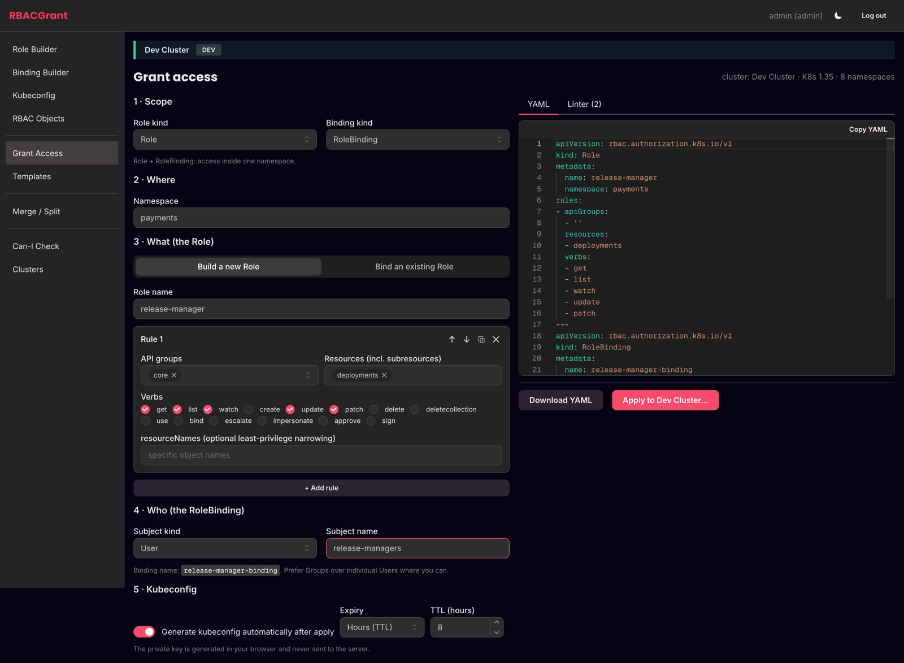

---

## Why this exists

Granting someone access to a cluster is a small task that goes wrong in big ways.
You write a Role, you guess at the right `apiGroups`, you bind it, and three months
later somebody notices the "read-only" role could read every Secret in the namespace.

RBACGrant makes the whole path explicit:

- **One form, four steps** — scope, where, what, who. The YAML updates as you type.
- **A risk linter** that scores the result and names the problem in plain language,
  based on the Kubernetes RBAC good-practices guidance.
- **Guardrails on apply** — some things need a typed reason, an admin, and your
  password again. A few things are refused outright.
- **A kubeconfig at the end**, because a grant nobody can use isn't finished.

It works fully offline. Connecting a cluster is optional and unlocks discovery,
dry-run, apply, live RBAC review and `can-i`.

---

## Table of contents

- [Quick start](#quick-start)
- [What it can do](#what-it-can-do)
- [Screenshots](#screenshots)
- [Running it properly](#running-it-properly)
  - [Generating the admin password hash](#generating-the-admin-password-hash)
  - [Using HashiCorp Vault](#using-hashicorp-vault)
  - [Docker](#docker)
- [User manual](#user-manual)
  - [Before you create a binding](#before-you-create-a-binding)
  - [Connecting a cluster](#connecting-a-cluster)
  - [Giving someone access, end to end](#giving-someone-access-end-to-end)
  - [Handing over the kubeconfig](#handing-over-the-kubeconfig)
  - [Reviewing what already exists](#reviewing-what-already-exists)
- [The operator identity](#the-operator-identity)
- [Verifying the image you downloaded](#verifying-the-image-you-downloaded)
- [Configuration reference](#configuration-reference)
- [Security model](#security-model)
- [Development](#development)

---

## Quick start

### Docker

```bash
docker run --rm -p 127.0.0.1:8080:8080 \
  -e RBAC_UI_ADMIN_PASSWORD='pick-a-password-here' \
  -e RBAC_UI_ALLOW_INSECURE_HTTP=true \
  shamsimran/rbacgrant:latest
```

Open <http://127.0.0.1:8080> and log in as `admin`. No cluster is registered, so
nothing is stored anywhere — build roles, lint them, download YAML.

Both flags are needed because a container binds `0.0.0.0` internally so that
`-p` can reach it:

- `RBAC_UI_ALLOW_INSECURE_HTTP=true` acknowledges there is no TLS *inside* the
  container. Publishing on `127.0.0.1:8080` keeps it off your network; in a real
  deployment you terminate TLS in front and set `RBAC_UI_PUBLIC_URL` to the
  HTTPS address.
- A password is required because the no-login mode below refuses any
  non-loopback bind address, which a container always has.

For a throwaway password, `RBAC_UI_ADMIN_PASSWORD` is hashed in memory at
startup and dropped from the environment. For anything you keep, use
`RBAC_UI_ADMIN_PASSWORD_HASH` — see
[generating the hash](#generating-the-admin-password-hash).

### From source — no login at all

```bash
git clone https://github.com/shams-imran/RBACGrant.git
cd RBACGrant
RBAC_UI_AUTH_MODE=none make run      # http://127.0.0.1:8080
```

This is the Personal profile: no login, no cluster, nothing written anywhere.
It binds `127.0.0.1` directly, which is the one situation where the server
permits authentication to be switched off — so it works from source but, by
design, **not** in a container.

`make run` builds the frontend, generates the offline API catalog and starts the
server. First run takes a few minutes; after that it's seconds.

---

## What it can do

| | |
|---|---|
| **Build** | Role / ClusterRole rule editor with pickers fed from your cluster's real API surface (CRDs and subresources included), presets, aggregation rules. Bindings across many namespaces at once, with the ServiceAccount created in the same bundle. |
| **Preview** | Live Monaco YAML pane. Export as one YAML file, a per-object zip, `kubectl create` commands, or a Kustomize overlay. |
| **Lint** | ~30 rules across critical → info, a least-privilege score, and a suggestion attached to every finding. The same rules run against RBAC already in your cluster. |
| **Guard** | Hard blocks that cannot be overridden (binding `system:anonymous`, touching the tool's own operator identity). Overridable blocks that need the admin role, a typed reason, and password re-entry — all written to the audit log. |
| **Kubeconfigs** | ServiceAccount tokens via TokenRequest with a TTL cap, or user certificates where **the private key is generated in your browser** and never reaches the server. |
| **Clusters** | Upload a kubeconfig → validated as untrusted input → stored encrypted (AES-256-GCM locally, or Vault KV v2). Credentials are write-only: no API route can read one back. |
| **Live cluster** | Discovery-driven pickers, server-side-apply with dry-run, `can-i` checks, live RBAC review with risk scoring, prod typed-confirmation. |
| **Offline** | Everything except the cluster features works with no network at all. A bundled API catalog covers Kubernetes 1.24 – 1.31. |

---

## Screenshots

<table>
<tr>
<td width="50%">

**The linter, while you type**

Score, severity, and what to do about it.

</td>
<td width="50%">

**Live cluster review**

The same rules, run against what's already there.

</td>
</tr>
<tr>
<td>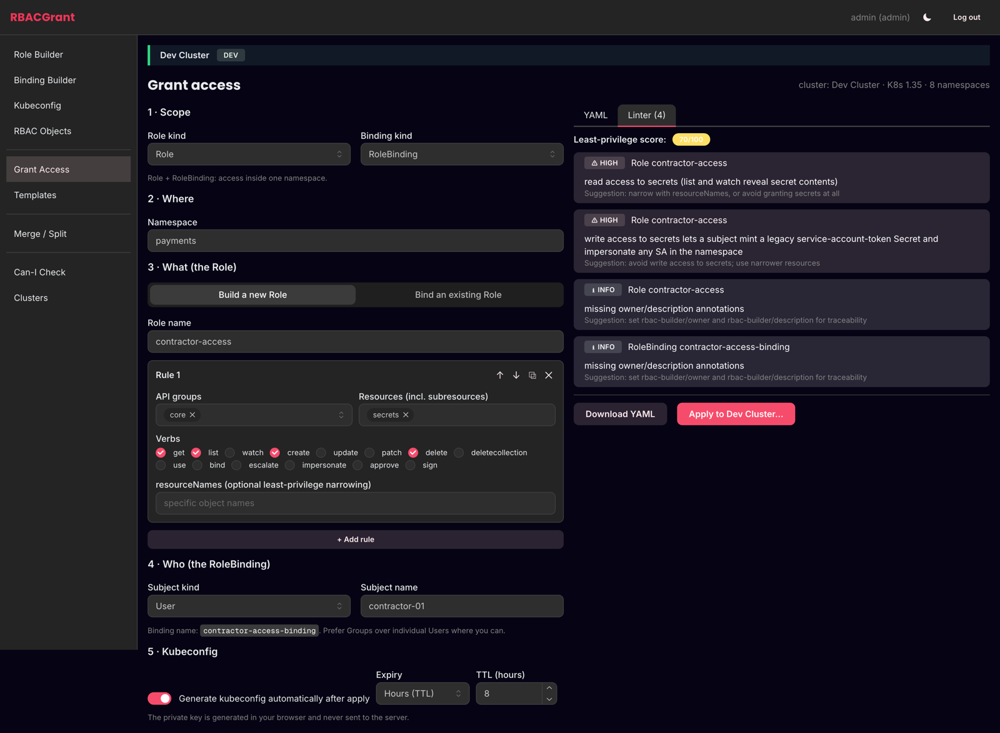</td>
<td>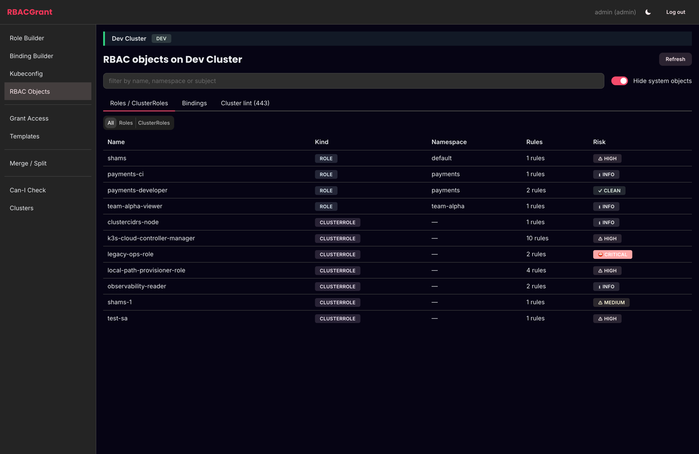</td>
</tr>
<tr>
<td>

**Kubeconfig generation**

SA token or browser-generated user cert, with an expiry you pick.

</td>
<td>

**Cluster registry**

Credentials go in encrypted and never come back out.

</td>
</tr>
<tr>
<td>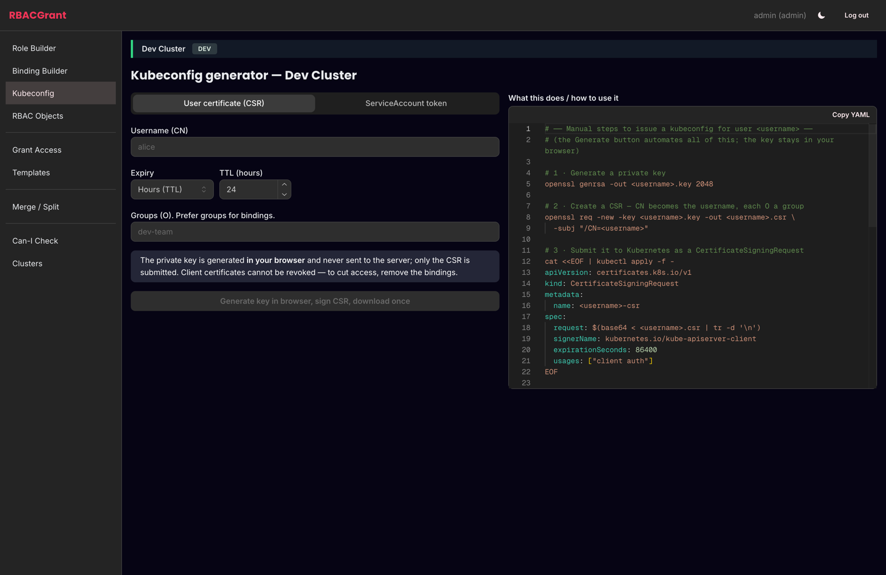</td>
<td>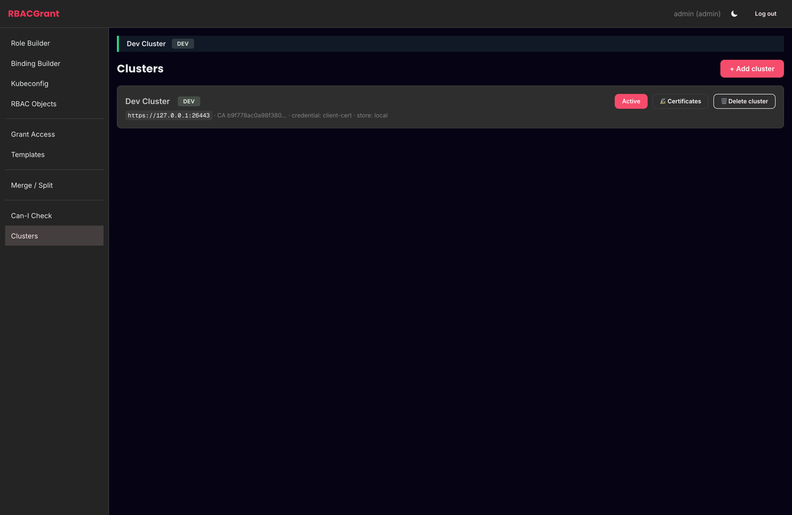</td>
</tr>
<tr>
<td>

**`can-i`, for somebody else**

SubjectAccessReview without the kubectl incantation.

</td>
<td>

**Starter templates**

Seven reviewed starting points, including the operator identities.

</td>
</tr>
<tr>
<td>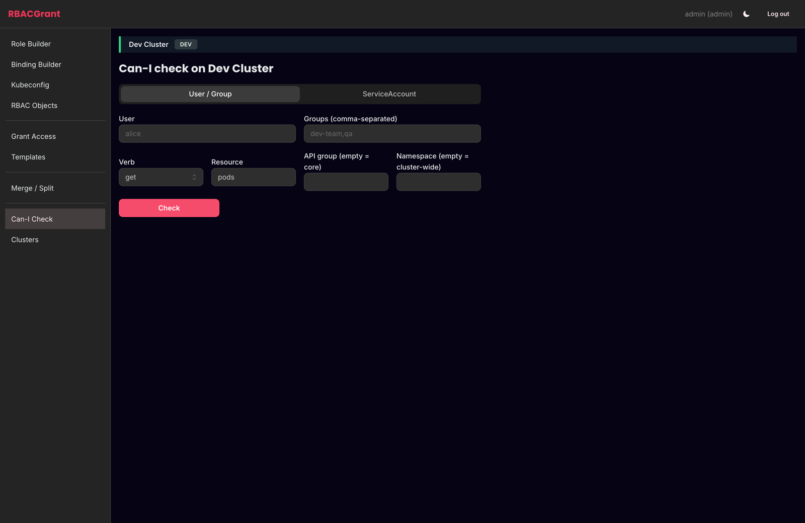</td>
<td>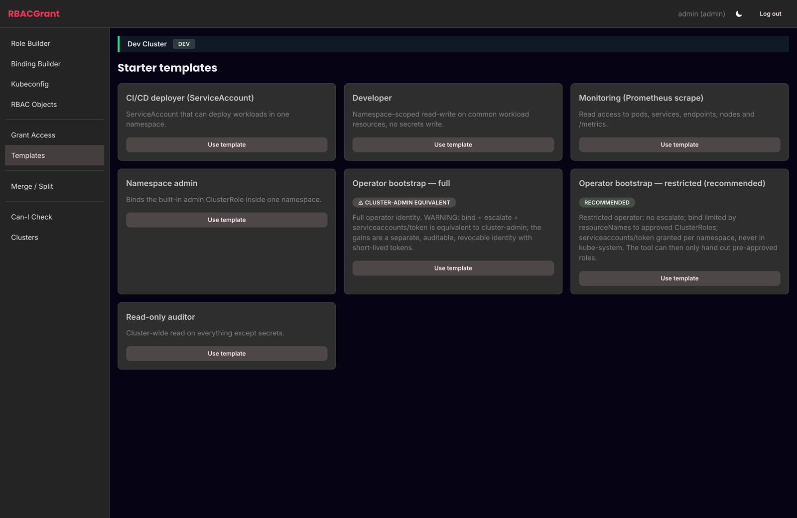</td>
</tr>
</table>

<details>
<summary>More — login, role builder, kubeconfig merge/split, cluster-wide lint</summary>

| | |
|---|---|
| 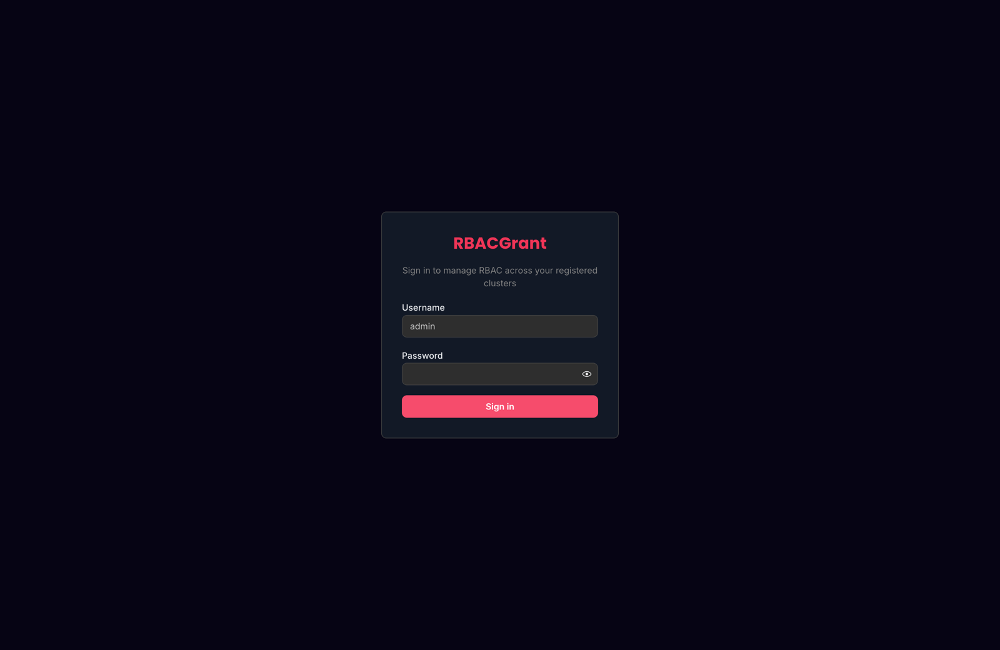 | 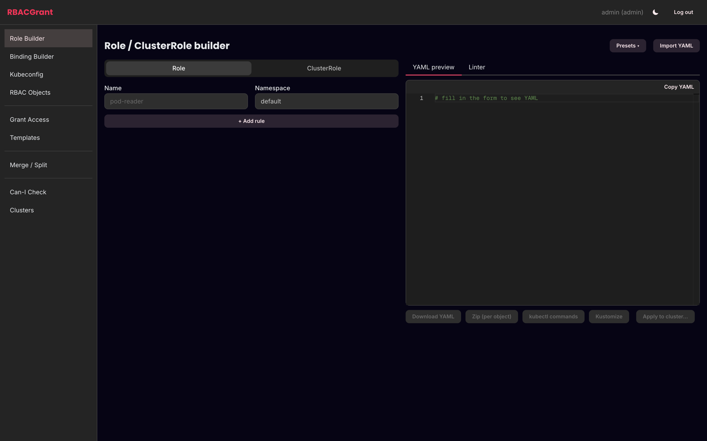 |
| 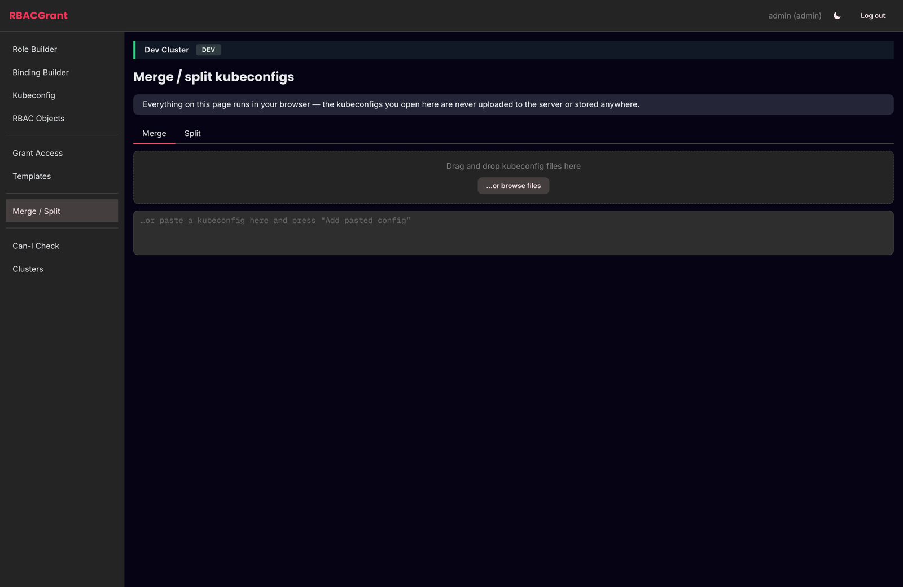 | 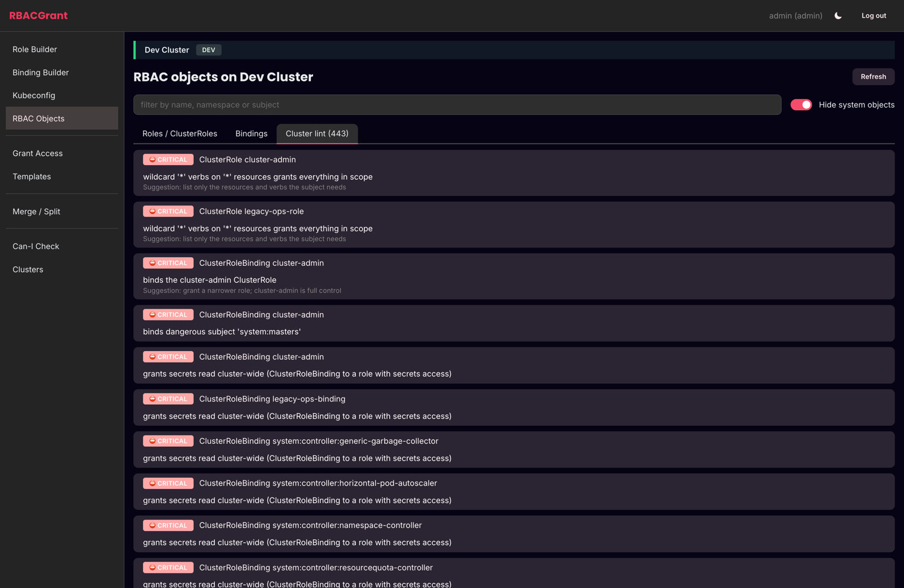 |

</details>

---

## Running it properly

The 30-second command above is the **Personal profile**: no login, no stored
credentials, loopback only. To register clusters you need the **Team server
profile**, which means a login and an encrypted store.

### Generating the admin password hash

There is no default password. The server refuses to start without one, and it
would rather you store an Argon2id hash than a plaintext password.

```bash
# from source
.venv/bin/rbac-ui hash-password

# or with the container
docker run --rm -it --entrypoint python shamsimran/rbacgrant:latest -m app.cli hash-password
```

It prompts twice (no echo), enforces the password policy, and prints something
like:

```
$argon2id$v=19$m=65536,t=3,p=4$c29tZXNhbHQ$RdescudvJCsgt3ub+b+dWRWJTmaaJObG
```

Put that in your `.env`:

```bash
RBAC_UI_ADMIN_USERNAME=admin
RBAC_UI_ADMIN_PASSWORD_HASH='$argon2id$v=19$m=65536,t=3,p=4$...'
```

> **Quote it.** The hash contains `$` characters. In a shell-sourced file or a
> `docker run -e` argument, an unquoted hash gets mangled by variable expansion
> and your login will silently fail with "invalid username or password".

Three ways to supply the password, in order of preference:

| Variable | What it holds | Notes |
|---|---|---|
| `RBAC_UI_ADMIN_PASSWORD_REF` | a *reference* to the secret | best — see [Vault](#using-hashicorp-vault) below |
| `RBAC_UI_ADMIN_PASSWORD_HASH` | the Argon2id hash | good — the plaintext never exists on the server |
| `RBAC_UI_ADMIN_PASSWORD` | the plaintext | last resort — hashed in memory at startup, then dropped from the environment, and you get a warning in the log |

### The encrypted cluster store

```bash
# a 32-byte key, base64 — and it must NOT live inside the data dir
openssl rand -base64 32 > /etc/rbacgrant/store.key
chmod 600 /etc/rbacgrant/store.key
```

```bash
RBAC_UI_CLUSTER_STORE=local
RBAC_UI_STORE_KEY_REF=file:/etc/rbacgrant/store.key
RBAC_UI_DATA_DIR=/var/lib/rbacgrant
```

Each cluster becomes one AES-256-GCM file whose associated data is the cluster
name, so a file renamed or swapped on disk fails to decrypt rather than silently
impersonating another cluster.

Maintenance:

```bash
rbac-ui store verify                        # does every stored file still decrypt?
rbac-ui store rotate-key                    # re-encrypt everything under a new key
rbac-ui store migrate --from local --to vault
```

### Using HashiCorp Vault

Vault can hold both the admin password and the cluster store. Any setting that
takes a secret accepts a **secret ref** instead of a value:

```
env:NAME                      an environment variable
file:/absolute/path           a file (must be mode 0600)
vault:<mount>/<path>#<field>  a Vault KV v2 field
sops:/absolute/path#<field>   a SOPS-encrypted file
```

**1. Store the secrets in Vault**

```bash
vault kv put secret/rbacgrant/admin \
  password='$argon2id$v=19$m=65536,t=3,p=4$...'

vault kv put secret/rbacgrant/store-key \
  key="$(openssl rand -base64 32)"
```

**2. Give the app a policy that can read them and manage its cluster entries**

```hcl
# rbacgrant-policy.hcl
path "secret/data/rbacgrant/admin"      { capabilities = ["read"] }
path "secret/data/rbacgrant/store-key"  { capabilities = ["read"] }

# the cluster registry: one KV v2 secret per cluster
path "secret/data/rbacgrant/clusters/*"     { capabilities = ["create","read","update","delete"] }
path "secret/metadata/rbacgrant/clusters/*" { capabilities = ["read","list","update","delete"] }
```

```bash
vault policy write rbacgrant rbacgrant-policy.hcl
```

**3. Point the app at Vault**

```bash
# Vault connection (standard Vault env vars)
VAULT_ADDR=https://vault.internal:8200
VAULT_CACERT=/etc/ssl/certs/vault-ca.pem      # TLS verification is mandatory

# how to authenticate
RBAC_UI_VAULT_AUTH_METHOD=approle             # token | approle | kubernetes
RBAC_UI_VAULT_ROLE_ID=<role-id>
RBAC_UI_VAULT_SECRET_ID_FILE=/run/secrets/vault-secret-id   # mode 0600

# where things live
RBAC_UI_VAULT_KV_MOUNT=secret
RBAC_UI_VAULT_PATH_PREFIX=rbacgrant

# use Vault for both the password and the cluster store
RBAC_UI_ADMIN_PASSWORD_REF=vault:secret/rbacgrant/admin#password
RBAC_UI_CLUSTER_STORE=vault
RBAC_UI_STORE_KEY_REF=vault:secret/rbacgrant/store-key#key
```

Auth methods:

- **`token`** — `VAULT_TOKEN`, or `RBAC_UI_VAULT_TOKEN_FILE` pointing at a 0600 file.
- **`approle`** — `RBAC_UI_VAULT_ROLE_ID` + `RBAC_UI_VAULT_SECRET_ID_FILE`.
- **`kubernetes`** — `RBAC_UI_VAULT_K8S_ROLE`; the pod's own ServiceAccount token
  is used to log in. This is the right choice when RBACGrant runs in-cluster.

Two things worth knowing:

- `VAULT_SKIP_VERIFY` is **refused**. The server will not start with TLS
  verification disabled.
- Password rotation is picked up automatically. A background watcher re-reads the
  password source every 60s; when the value actually changes, that user's sessions
  are revoked. A Vault outage never revokes anything — the last known hash is kept.

### Docker

Published for **linux/amd64** and **linux/arm64** as a single manifest list —
`docker pull` picks the right one automatically, on an Intel server or an
Apple Silicon laptop alike.

```bash
docker run -d --name rbacgrant \
  -p 127.0.0.1:8080:8080 \
  --env-file .env \
  -v rbacgrant-data:/data \
  -v /etc/rbacgrant/store.key:/etc/rbacgrant/store.key:ro \
  --read-only \
  --tmpfs /run/rbac-ui:rw,noexec,nosuid,size=16m,mode=0700,uid=10001,gid=10001 \
  -e RBAC_UI_RUNTIME_DIR=/run/rbac-ui \
  -e RBAC_UI_ALLOW_INSECURE_HTTP=true \
  --cap-drop ALL \
  --security-opt no-new-privileges \
  --user 10001 \
  shamsimran/rbacgrant:1.0.0
```

> Publish on **loopback only**. A bare `-p 8080:8080` binds every interface, and
> this app holds cluster admin credentials.

For a real deployment put TLS in front of it and set `RBAC_UI_PUBLIC_URL` to the
HTTPS URL — the server refuses plain HTTP off-loopback unless you explicitly set
`RBAC_UI_ALLOW_INSECURE_HTTP=true` (for when you terminate TLS at a trusted proxy).

Compose and Kubernetes manifests live in [`deploy/`](deploy/).

---

## User manual

### Before you create a binding

Five minutes of thinking here saves an incident later.

**1. Know who the subject really is.**

| Subject kind | Use it for | Watch out for |
|---|---|---|
| `Group` | humans, almost always | groups come from your identity provider — Kubernetes does not manage them |
| `User` | one specific person, rarely | there's no user object; it's whatever your authenticator asserts |
| `ServiceAccount` | workloads and CI | lives in a namespace; a token for it is a bearer credential |

Prefer `Group`. Binding individual users means a cleanup task nobody does.

**2. Decide the blast radius before you pick the verbs.**

| What you need | Role kind | Binding kind |
|---|---|---|
| Access inside one namespace | `Role` | `RoleBinding` |
| The same access in several namespaces | `ClusterRole` | one `RoleBinding` per namespace |
| Access to cluster-scoped things (nodes, PVs, CRDs) | `ClusterRole` | `ClusterRoleBinding` |

A `ClusterRoleBinding` is cluster-wide **and** covers every namespace that exists
*and every one created later*. If you only need three namespaces, pick the middle
row — RBACGrant will fan out the RoleBindings for you.

**3. Know which verbs are quietly dangerous.**

- `get`/`list`/`watch` on **secrets** — reads every credential in scope.
- `create` on **pods** — can mount any Secret and run as any ServiceAccount in the namespace.
- `create` on **pods/exec** — a shell in a running container.
- `escalate` — lets the subject grant themselves permissions they don't have.
- `bind` — lets the subject bind any role, which is `escalate` with extra steps.
- `impersonate` — lets the subject act as anyone, including `system:masters`.
- `*` on anything — you will not remember what this covered in six months.

The linter flags every one of these. It isn't trying to stop you; it's making sure
the decision was deliberate.

**4. Check nothing already does the job.** Go to **RBAC Objects**, filter by the
namespace, and look. The built-in `view`, `edit` and `admin` ClusterRoles cover a
surprising share of real requests, and reusing one is better than a sixth bespoke
role.

**5. Have an expiry in mind.** Contractor access, incident access and "just for
today" access should be issued with a TTL, not revoked by memory.

### Connecting a cluster

Cluster features need a stored kubeconfig. This is the one genuinely sensitive
thing the app holds, so the flow is deliberate.

**First, make a dedicated identity — don't feed it your personal admin cert.**
See [the operator identity](#the-operator-identity) below.

Then: **Clusters → + Add cluster**.

1. **Paste or upload the kubeconfig.** It's treated as untrusted input. The server
   safe-parses it, rejects any reference to a local file on its own disk
   (`certificate-authority`, `client-key`, `tokenFile`), checks `exec` plugins
   against an allowlist, and resolves the API server address to make sure it isn't
   a link-local or cloud-metadata endpoint.
2. **Pick the context** if the file has several. Everything else is discarded —
   what gets stored is a normalized single-context kubeconfig.
3. **Review what it found**: the server URL, the CA fingerprint, the credential
   type, whether TLS verification is on, and whether another registered cluster
   has the same URL and CA (a duplicate under a different name).
4. **Name it and tag the environment.** `prod` is not cosmetic: it turns on typed
   confirmation and password re-entry for every apply and delete.
5. **Confirm with your password.** Saving a cluster is a step-up action.

Once saved, the credential is write-only. You can replace it or delete it; no
endpoint will hand it back. To rotate, use **Replace credentials** — if the server
URL or CA changed you'll be asked to acknowledge that explicitly, because it
usually means you pasted a different cluster.

Pre-registering clusters from config (handy for GitOps) is also possible, and
those entries are read-only in the UI:

```bash
RBAC_UI_CLUSTERS="prod-eu=vault:secret/rbacgrant/clusters/prod-eu#kubeconfig"
```

#### "The API server resolves to loopback"

The SSRF guard in step 1 refuses a kubeconfig whose server address resolves to
`127.0.0.0/8` or `::1`, because the server is about to make authenticated
requests to it. Without that check, anyone who can upload a kubeconfig could
aim RBACGrant at services only RBACGrant can reach — its own port, a sidecar,
anything bound to its localhost.

Local clusters hit this constantly: k3d, kind, OrbStack and Docker Desktop all
write `server: https://127.0.0.1:PORT` into your kubeconfig.

| | `RBAC_UI_ALLOW_LOOPBACK_API_SERVERS=false` (default) | `=true` |
|---|---|---|
| Loopback API server | refused at upload | accepted |
| Metadata IP (`169.254.169.254`) | refused | **still refused** |
| Other link-local | refused | **still refused** |

So the flag widens exactly one thing, and **where RBACGrant runs decides
whether it helps**:

- **Running on your own machine** (`make run`, or a container with
  `--network=host`) — `127.0.0.1` really is your local cluster's API server.
  Set `RBAC_UI_ALLOW_LOOPBACK_API_SERVERS=true` and upload the kubeconfig
  unchanged.
- **Running in a pod or a bridged container** — `127.0.0.1` is that container's
  own network namespace, so the flag cannot make the kubeconfig work; it just
  turns a clear error into a connection timeout. Leave it `false` and rewrite
  the address to one the container can reach. For the cluster RBACGrant is
  deployed in, that's the in-cluster service name:

  ```bash
  kubectl config view --minify --raw \
    | sed 's|https://127.0.0.1:PORT|https://kubernetes.default.svc|' \
    > cluster-inpod.kubeconfig
  ```

  The API server's serving certificate already covers
  `kubernetes.default.svc`, so the `certificate-authority-data` in your
  kubeconfig keeps verifying — no `insecure-skip-tls-verify` needed.

### Giving someone access, end to end

**Grant Access** is the whole flow on one page. The YAML on the right updates as
you type and the Linter tab keeps a running count.

**1 · Scope** — pick the Role kind and Binding kind. The combinations that
Kubernetes forbids are prevented here: choose `ClusterRoleBinding` and the role
kind snaps to `ClusterRole`, because a `ClusterRoleBinding` cannot reference a
namespaced `Role`.

**2 · Where** — the namespace. With a cluster connected this is a picker of real
namespaces. For a `ClusterRole` + `RoleBinding` grant you can select several and
get one RoleBinding per namespace.

**3 · What** — either build a new Role or bind an existing one (the picker lists
the cluster's real roles plus the built-in `view` / `edit` / `admin` /
`cluster-admin`). When building: pick API groups, then resources — the list comes
from the live cluster, so your CRDs are there — then verbs. `resourceNames` is the
cheapest least-privilege win available: it narrows a rule to named objects.

**4 · Who** — subject kind and name. For a ServiceAccount that doesn't exist yet,
leave "create the ServiceAccount" on and it's added to the same bundle, ordered so
it exists before the binding references it.

**5 · Kubeconfig** — leave it on to generate credentials automatically once the
apply succeeds.

Then either:

- **Download YAML** — hand it to GitOps, or `kubectl apply -f` it yourself.
- **Apply to cluster…** — opens the apply dialog:
  - It runs a **dry-run** first (real server-side apply with `dryRun=All`), so you
    see what the API server says before anything changes.
  - **Hard blocks** stop here. No override exists.
  - **Overridable findings** need the admin role, a typed reason and your password
    again. The reason goes in the audit log next to the SHA-256 of the YAML.
  - On a **prod** cluster you type the cluster name to confirm.

Applied objects are annotated with who applied them and when, and the field
manager is set so later server-side applies behave.

### Handing over the kubeconfig

Two kinds, on the **Kubeconfig** page (or automatically after a Grant Access apply).

**ServiceAccount token** — a TokenRequest token, capped by
`RBAC_UI_MAX_TOKEN_TTL`. Shown once, never stored.

> An issued token **cannot be revoked** before it expires. Cutting access early
> means deleting the ServiceAccount or removing its bindings. Keep TTLs short.

**User certificate** — you give a username and groups; your **browser** generates
an ECDSA P-256 key, builds a CSR, and only the CSR goes to the server. The server
has Kubernetes sign it, returns the certificate, and the final kubeconfig is
assembled in the page. The private key never touches the server, the network, or
the audit log.

> Client certificates cannot be revoked either, and `system:` usernames and groups
> are refused outright — that path leads to `system:masters`, which is not
> subject to RBAC at all.

The downloaded file carries its expiry in a comment at the top. To use it:

```bash
export KUBECONFIG=~/Downloads/kubeconfig-dev-cluster-jane.doe-exp20260301T235900Z.yaml
kubectl auth whoami
kubectl get pods -n payments
```

**Merge / Split** does the obvious thing with kubeconfig files, entirely in your
browser — nothing is uploaded. Useful for folding a new context into someone's
existing config, or pulling one context out of a shared file.

### Reviewing what already exists

**RBAC Objects** lists every Role, ClusterRole and binding on the active cluster,
each with a risk badge from the same linter. "Cluster lint" totals it up.

Start with **Hide system objects** on — the `system:` roles are Kubernetes' own
and will dominate the list otherwise. Then sort your attention by the badges:
`CRITICAL` means a wildcard grant, a `cluster-admin` binding, or a binding to a
dangerous subject.

You can edit rules and subjects in place, or delete an object (step-up required,
and on prod you type the cluster name).

**Can-I Check** answers "can *this* subject do *this*" using SubjectAccessReview —
`kubectl auth can-i --as`, without the flags. Use it to verify a grant did what you
intended, and to prove to a reviewer that it didn't do more.

---

## The operator identity

RBACGrant acts on your cluster with whatever credential you gave it. Don't give it
your personal cluster-admin certificate. Both identities below ship as templates
in the app (**Templates** page):

- **`operator-restricted`** — recommended. No `escalate`; `bind` limited by
  `resourceNames` to an approved list of roles; token minting per namespace.
  It can do the job without being able to grant itself more.
- **`operator-full`** — labelled cluster-admin-equivalent, because `bind` +
  `escalate` + `serviceaccounts/token` is exactly that. Use it only if you
  understand that.

Apply the template, create a kubeconfig for that ServiceAccount, and register
*that* in the cluster registry.

The app also refuses to edit its own operator objects from the UI, so a mistake in
the tool can't quietly expand the tool's own powers.

---

## Verifying the image you downloaded

Every published image is **signed with Sigstore cosign** using GitHub's OIDC
identity — there is no private key to leak, and the signature proves which
workflow in which repository built it.

```bash
# 1. pin to the digest, not the tag
docker pull shamsimran/rbacgrant:1.0.0
docker inspect --format='{{index .RepoDigests 0}}' shamsimran/rbacgrant:1.0.0
# shamsimran/rbacgrant@sha256:abc123...

# 2. verify the signature
cosign verify \
  --certificate-identity-regexp '^https://github.com/shams-imran/RBACGrant/\.github/workflows/release\.yml@refs/tags/v' \
  --certificate-oidc-issuer https://token.actions.githubusercontent.com \
  shamsimran/rbacgrant@sha256:abc123... | jq .

# 3. check the build provenance (how it was built, from which commit)
cosign verify-attestation --type slsaprovenance \
  --certificate-identity-regexp '^https://github.com/shams-imran/RBACGrant/\.github/workflows/release\.yml@refs/tags/v' \
  --certificate-oidc-issuer https://token.actions.githubusercontent.com \
  shamsimran/rbacgrant@sha256:abc123...

# 4. read the SBOM — every package in the image
cosign download sbom shamsimran/rbacgrant@sha256:abc123... | jq '.components[].name'
```

The release notes for each version also list the digest, so you can compare what
you pulled against what was published without trusting the registry's tag
resolution.

**Run by digest in production.** Tags move; digests don't:

```yaml
image: shamsimran/rbacgrant@sha256:abc123...
```

See [`docs/RELEASING.md`](docs/RELEASING.md) for how releases are built and what
each signature covers.

---

## Configuration reference

Everything is environment variables, prefixed `RBAC_UI_`, optionally via a `.env`
file (mode 0600 — the server warns otherwise). [`.env.example`](.env.example) has
every variable with comments; the ones you'll actually touch:

| Variable | Default | What it does |
|---|---|---|
| `RBAC_UI_BIND_ADDR` | `127.0.0.1` | keep it on loopback unless TLS is in front |
| `RBAC_UI_PUBLIC_URL` | `http://127.0.0.1:8080` | used for Origin checks and cookie flags |
| `RBAC_UI_AUTH_MODE` | `local` | `local` or `none` (loopback + no store only) |
| `RBAC_UI_ADMIN_PASSWORD_HASH` | — | Argon2id hash; **quote it** |
| `RBAC_UI_CLUSTER_STORE` | `none` | `none`, `local` or `vault` |
| `RBAC_UI_STORE_KEY_REF` | — | required for `local`; must live outside the data dir |
| `RBAC_UI_SESSION_IDLE_TIMEOUT` | `15m` | idle logout |
| `RBAC_UI_STEP_UP_WINDOW` | `5m` | how long a password re-entry stays fresh |
| `RBAC_UI_MAX_TOKEN_TTL` | `7d` | hard cap on issued SA tokens |
| `RBAC_UI_MAX_CERT_TTL` | `7d` | hard cap on issued client certificates |
| `RBAC_UI_READ_ONLY` | `false` | global kill switch for every cluster write |
| `RBAC_UI_AUDIT_LOG_FILE` | — | JSON-lines audit log, in addition to stdout |
| `RBAC_UI_ALLOWED_API_SERVERS` | — | allowlist of API server hosts |
| `RBAC_UI_ALLOW_LOOPBACK_API_SERVERS` | `false` | accept a kubeconfig whose API server resolves to loopback — see [below](#the-api-server-resolves-to-loopback) |

---

## Security model

Short version — [`SECURITY.md`](SECURITY.md) has the detail:

- **Argon2id** password hashing, per-IP lockout with escalating delays, and a
  generic error that never reveals whether a username exists.
- **Server-side sessions**, `__Host-` cookie, `SameSite=Strict`, CSRF
  synchronizer token on every state-changing request, Host allowlist against DNS
  rebinding, strict CSP with no CDN (fonts and Monaco are bundled).
- **Credentials at rest** encrypted with the cluster name as AEAD associated data;
  decrypted only for the request that needs them, into a 0700 runtime dir that is
  wiped on startup, shutdown and after each use. Never `/tmp`.
- **Issued credentials are never stored** and never logged. Log output is scrubbed
  for Argon2 hashes, JWTs, PEM private keys and Vault tokens.
- **Audit log** of every meaningful action: who, from where, which cluster, what,
  the result, and the SHA-256 of any applied YAML.
- **Hardened container**: non-root UID 10001, no package managers in the final
  image, read-only rootfs ready, all capabilities dropped.

Not yet implemented, deliberately: TOTP/OIDC, cloud secret managers, two-person
approval, an audit hash chain, and general API rate limiting (login brute-force
protection *is* there).

Found something? See [`SECURITY.md`](SECURITY.md) for how to report it.

---

## Development

```bash
make run      # build frontend + catalog, run the server
make dev      # backend (auth off) + Vite dev server with hot reload
make test     # backend pytest + frontend tsc + vitest
make docker   # build the container image
```

Layout:

```
backend/app/     auth secrets store security models generators linter k8s catalog routers
frontend/src/    pages components theme api crypto lib
deploy/          compose + Kubernetes manifests
docs/            screenshots, release process
```

[`ARCHITECTURE.md`](ARCHITECTURE.md) explains how the pieces fit together and why.

Contributions welcome — please run `make test` before opening a PR.

---

## License

MIT — see [`LICENSE`](LICENSE).
